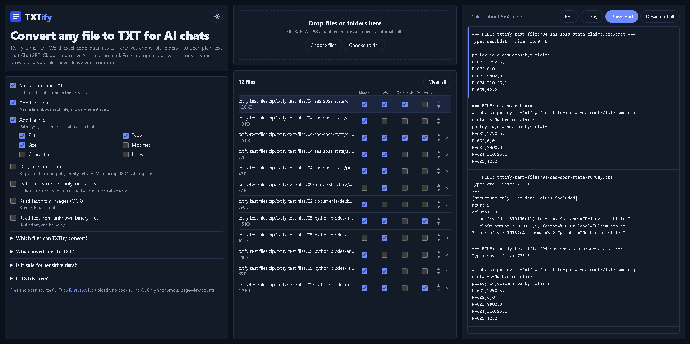

  

<h1 align="center">TXTify</h1>

  <b>Any file in. Plain text out.</b> 
  Convert documents, code, data files, archives and whole folders into clean TXT for ChatGPT, Claude and other AI chats. 
  Free, open source, and everything runs in your browser.

  <a href="https://rihalabs.github.io/txtify/"><b>Open TXTify</b></a> &nbsp;·&nbsp;
  <a href="DOCS.md">How it works</a>

  
  
  
  

<!-- Add a screenshot after deploying:  

 -->

## Why TXTify

AI chats and agents often refuse XLSX, ZIP, SAS or Parquet files, but they always accept plain text, and plain text is cheap in tokens. TXTify turns almost anything into one tidy TXT you can paste or upload. No account, no server, no AI service.

## Features

- **Folders and archives:** drop files, a whole folder, or ZIP / RAR / 7z / TAR archives (nested too).
- **Merge or split:** one merged TXT, or one file at a time, plus a ZIP with a TXT per file.
- **File name and file info:** choose what appears above each file (name, path, type, size, date, characters, lines), globally or per file.
- **Only relevant content:** skips notebook outputs, empty spreadsheet cells, HTML markup and JSON whitespace.
- **Structure only, no values:** for data files, export just column names, types and row counts. Made for sensitive data.
- **Edit before you copy:** fix or redact the text, then copy or download it.
- **Reorder, remove, retry:** arrows to reorder, one-click removal of files that could not be converted.
- **Light and dark mode.**

## Supported formats

| Category | Formats |
| --- | --- |
| Text and code | txt, md, py, js, sql, sas, json, yaml, toml, ini, xml, svg, html, css, csv, tsv, logs, and any other text file (UTF-8, UTF-16, Windows-1252) |
| Documents | pdf (text layer), docx, pptx, odt, odp, rtf, epub, Jupyter notebooks |
| Spreadsheets and data | xlsx, xls, ods, dbf and more, sas7bdat, xpt, SPSS sav, Stata dta, Parquet, SQLite, NumPy npy and npz, Python pickle (pkl) |
| Archives | zip, rar, 7z, tar, gz, bz2, xz, cab, iso, SAS egp, and more |
| Images | size, plus optional OCR (English) |
| Anything else | optional best-effort extraction of readable strings from unknown binary files |

## Privacy

- Your files are processed inside your browser and are never uploaded.
- The app contains no network calls that carry file contents, no cookies and no tracking scripts.
- A Content-Security-Policy makes the browser itself block connections to everything except the library CDN (`cdn.jsdelivr.net`) and, if the site owner enabled it, one anonymous page-view counter image.
- Python pickle files are read as plain data and never executed.
- Details and how to verify this yourself: see [DOCS.md](DOCS.md).

## Run it yourself

TXTify is a static site with no build step. Open `index.html` in a browser, or host the files on any static host. Keep `data-engines.js` and `logo.svg` next to `index.html`.

## Project files

| File | Purpose |
| --- | --- |
| `index.html` | The whole app: interface, styles and logic |
| `data-engines.js` | Bundled readers for SAS, SPSS, Stata, Parquet and pickle files |
| `engines-src/` | Source and build script for `data-engines.js` |
| `logo.svg` | Logo, browser tab icon and README icon |
| `og-image.png`, `sitemap.xml` | Link preview image and search engine sitemap |
| `DOCS.md` | Detailed documentation |

## Credits

Built on JSZip, SheetJS, mammoth.js, pdf.js, Tesseract.js, sql.js, 7z-wasm (7-Zip), statfmt (a ReadStat port), hyparquet and pickleparser.

## License

[MIT](LICENSE) © RihaLabs
